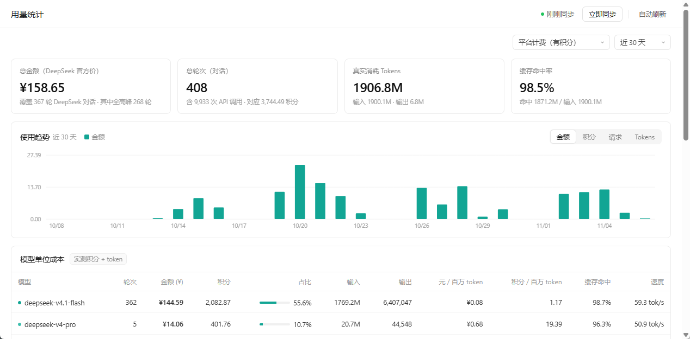

# Buddy Usage Dashboard

[简体中文](README.md) | **English**

A zero-dependency local dashboard. It reads the runtime data the **WorkBuddy desktop client** leaves on your machine and works out how many tokens you burn each day, how much cache you hit, and what it costs.

Open it in a browser and you get a plain white page: four metric cards, a daily trend chart, a per-model cost table, and a request log you can click into for detail.



> The numbers in the screenshot are sample data. Real figures come from the usage records under `~/.workbuddy` on your own machine.

## Where the data comes from

All of it comes from the local WorkBuddy client — **no network calls, no uploads**:

| File | What it gives you |
| --- | --- |
| `~/.workbuddy/workbuddy.db` | `session_usage.credit_json`: credits charged per turn; `sessions`: conversation titles and working directories |
| `~/.workbuddy/projects/*/*.jsonl` | `providerData.rawUsage` on every assistant message: input/output tokens, cache hits, per-step credits, model name |

The data directory can be overridden with `--data-dir` or the `WORKBUDDY_HOME` environment variable; it defaults to `~/.workbuddy`.

## Running it

Python 3.8+, **standard library only** — there is nothing to pip install.

```bash
python dashboard.py                 # start the server and open your browser (127.0.0.1:8765)
python dashboard.py --port 9000     # use a different port
python dashboard.py --once          # just write a static snapshot to index.html
python dashboard.py --data-dir D:/wb-data   # point at another data directory
```

If you would rather not type commands:

- Windows: double-click `start.bat`
- macOS / Linux: `./start.sh`

「立即同步」 (Sync now) re-scans and redraws. With 「自动刷新」 (Auto refresh) on, it syncs silently every 60 seconds.

## Two definitions that matter

**1. The unit is a *turn*, not an API call**

A single `conversationRequestId` usually carries dozens of `stepSeq` entries — every tool call you trigger is another round trip to the API. The dashboard sums tokens and cost across all steps in a turn and takes the credits as the turn total, which is the only way the numbers line up with the "total consumed" figure the client shows.

**2. Costs are converted with DeepSeek's official price list, peak and off-peak**

Prices live in `PRICES` in `dashboard.py`, in CNY per million tokens:

| Model | Cache hit | Cache miss | Output |
| --- | --- | --- | --- |
| deepseek-flash | 0.02 / 0.04 | 1.0 / 2.0 | 4.0 / 8.0 |
| deepseek-v4-pro | 0.15 / 0.30 | 4.5 / 9.0 | 13.5 / 27.0 |

The number before the slash is off-peak, the one after is peak. Peak = Beijing time, Mon–Fri 09:00–12:00 and 14:00–18:00; every other hour and all weekend is off-peak. Each step is judged by its own timestamp, so a turn that straddles peak and off-peak is priced in segments.

Third-party models (glm / kimi / minimax / mimo and friends) have no public price list. Their cost column stays empty — the dashboard reports tokens and credits rather than inventing a number.

## Known limitations

- **Time to first token (TTFT)**: the client's local data has no such field, so the "first token" column is always empty. Speed is estimated as output tokens ÷ turn duration, which includes tool calls and client overhead — it is not pure model latency.
- **Public holidays**: workdays are decided by weekday alone; the `HOLIDAYS` set is empty by default. Add dates to it if you need precision.
- **Data lag**: after a turn ends, logs and credits keep being written for a few more minutes. The turn you just finished may read low and is marked 「进行中」 (in progress) in the table.
- **Depends on undocumented client internals**: the `workbuddy.db` schema and the jsonl fields are not a public API and may change when the client updates. If they do, fix the `parse_file()` and `load_credits()` functions.

## License

MIT
