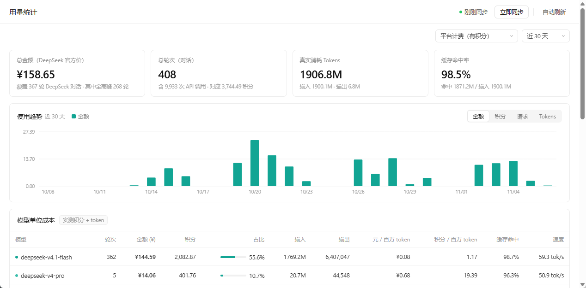
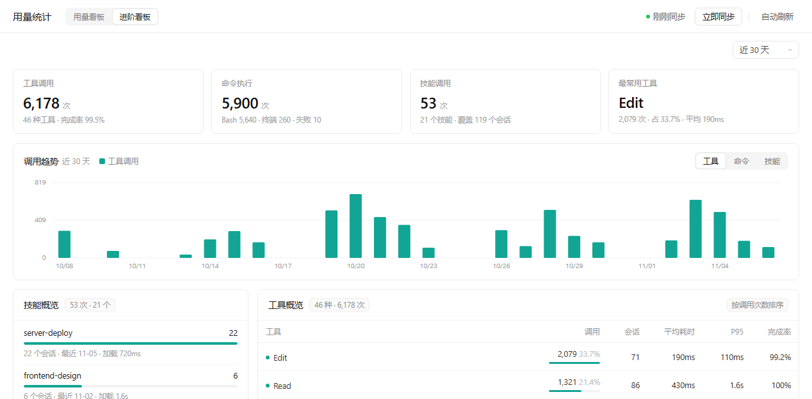

# Buddy 用量看板

**简体中文** ｜ [English](README.en.md)

一个零依赖的本地看板，读取 **WorkBuddy 桌面客户端** 留在本机的运行数据，统计每天用掉多少 token、命中多少缓存、花了多少钱。

浏览器打开后是一个白底极简页面：四张指标卡、一张按日趋势图、一张模型成本表、一份可点开明细的请求日志。顶部三个视图切换：**用量看板** 看钱、**进阶看板** 看技能与工具、**会话明细** 看单个会话每一步到底发生了什么（也可直接用 `index.html#adv`、`index.html#sess` 打开）。



> 截图中的数字为示例数据，实际统计来自你本机 `~/.workbuddy` 下的用量记录。

## 数据从哪来

全部来自本机的 WorkBuddy 客户端，**不联网、不上传**：

| 文件 | 用途 |
| --- | --- |
| `~/.workbuddy/workbuddy.db` | `session_usage.credit_json`：每轮对话扣了多少积分；`sessions`：会话标题与工作目录 |
| `~/.workbuddy/projects/*/*.jsonl` | `providerData.rawUsage`：每条 assistant 消息的输入/输出 token、缓存命中、单步积分、模型名；`function_call` / `function_call_result`：工具名、入参、状态，是进阶看板的原始素材 |

数据目录可以用 `--data-dir` 或环境变量 `WORKBUDDY_HOME` 指定，默认 `~/.workbuddy`。

## 运行

需要 Python 3.8+，**只用标准库**，不需要 pip 安装任何东西。

```bash
python dashboard.py                 # 启动服务并自动打开浏览器（127.0.0.1:8765）
python dashboard.py --port 9000     # 换端口
python dashboard.py --once          # 只生成一份静态快照 index.html
python dashboard.py --data-dir D:/wb-data   # 指定数据目录
```

不想敲命令的话：

- Windows：双击 `start.bat`
- macOS / Linux：`./start.sh`

`start.bat` 会自动挑一个能用的 Python，按这个顺序找：

1. 环境变量 `WORKBUDDY_PYTHON` 指定的路径
2. WorkBuddy 自带 Python（`%USERPROFILE%\.workbuddy\binaries\python`）
3. WorkBuddy 安装目录里的 `resources\vendor\python`
4. `py -3` 启动器解析出的真实 exe
5. PATH 里的 `python` / `python3`
6. 常见安装位置（Anaconda、Miniconda、`Programs\Python\Python3*`、`C:\Python3*`）

每个候选都要真跑一次 `python -c "import sys"` 才算数，所以 Windows 商店那个 0 字节的
`python.exe` 占位程序会被自动跳过——以前双击 `start.bat` 会跳应用商店，就是踩了这个坑。

> `start.bat` 本身必须保持 **GBK(cp936) + CRLF**。cmd 解析 UTF-8 中文批处理时
> `goto` / `call` 会按错误字节偏移跳转，从某行中间接着执行，表现为乱码加一串
> 「不是内部或外部命令」。用编辑器的 UTF-8 另存会把这个问题带回来。

页面上的「立即同步」会重新扫描并重绘；「自动刷新」开启后每 60 秒静默同步一次。

## 版本

版本号只写在根目录 `VERSION` 一个文件里，服务、页面页脚和离线包都从它读。

```bash
curl -s http://127.0.0.1:8765/api/health
# {"ok": true, "product": "buddy-context", "version": "0.1.0"}
```

发版后先打这个接口，返回的 `version` 和 git tag、`docs/versions.json` 里的一致才算发布完成。离线包的文件名也带版本号（`minitool-usage-dashboard-0.1.0.zip`），页脚同样显示版本。

每一版为什么改、改了什么，写在 [`docs/versions.json`](docs/versions.json)，可直接打印的看板是 `docs/version-board.html`；发版流程与回滚办法见 [`docs/VERSIONING.md`](docs/VERSIONING.md)。

## 两个关键口径

**1. 统计单位是「一轮对话」，不是「一次 API 调用」**

同一个 `conversationRequestId` 下面通常挂着几十次 `stepSeq`——你每触发一次工具调用，就是一轮 API 请求。看板把一轮里所有 step 的 token 与金额累加，积分取整轮的合计，这样才和客户端显示的「共消耗」对得上。

**2. 金额按 DeepSeek 官方价目折算，且有峰谷**

价格写在 `dashboard.py` 的 `PRICES` 里，单位是「元 / 百万 tokens」：

| 模型 | 缓存命中 | 缓存未命中 | 输出 |
| --- | --- | --- | --- |
| deepseek-flash | 0.02 / 0.04 | 1.0 / 2.0 | 4.0 / 8.0 |
| deepseek-v4-pro | 0.15 / 0.30 | 4.5 / 9.0 | 13.5 / 27.0 |

斜杠前是空闲时段、斜杠后是高峰时段。高峰 = 北京时间周一至周五 9:00–12:00、14:00–18:00，其余时间及周末按空闲价。每一步都按它自己发生的时刻判定，所以一轮跨越峰谷时是分段计价。

峰谷标记对所有模型生效：非 DeepSeek 模型没有价目、金额留空，但同样会标出这一轮有没有落在高峰里。请求日志的时间列显示这一轮的起止时刻（如 `11-06 17:55-18:00`），旁边的「峰」表示 40 次调用全部在高峰，「峰 95%」表示只有部分调用在高峰，没有标签则是全在空闲时段。

非 DeepSeek 模型（glm / kimi / minimax / mimo 等）没有公开价目，金额列留空，只统计 token 与积分，不会编一个数出来。

## 进阶看板：技能 / 工具 / 命令

顶部切换到「进阶看板」，或直接访问 `index.html#adv`。这一页不看 token 与金额，只看三件事，而且三类互不重叠，加起来正好是全部函数调用：



| 类别 | 判定依据 | 页面能看到什么 |
| --- | --- | --- |
| 技能 | `Skill` 工具调用 | 每个技能被调用几次、覆盖多少个会话、最近一次使用、加载耗时 |
| 命令 | `Bash` 与终端命令 | 命令总数、Bash / 终端占比、失败次数、命令族分布、最近执行明细 |
| 工具 | 其余全部函数调用（含 MCP） | 调用次数、会话数、平均耗时、P95、完成率 |

几个口径：

- **单次耗时** = `function_call` 到同 `callId` 的 `function_call_result` 之间的时间差，包含工具真实执行时间；超过 30 分钟没有结果的，视为无结果，不计入平均。
- **`DeferExecuteTool` 会拆壳**：按入参里的真实工具名归类（例如 `mcp__chrome-devtools__take_screenshot`），否则工具榜上全是同一层没有信息量的「代调用」。
- **完成率** = 状态为 `completed` 的结果数 ÷ 有结果的调用数。被中断、还在跑的调用不进分母，所以这一列通常很高，只有真出错才会掉下来。
- **命令族**取命令的首个可执行名，自动剥离开头的 `cd … &&`、环境变量和 `sudo`，所以 `cd "D:/x" && python a.py` 记在 `python` 名下；`for` / `while` 这类循环记作 `shell 循环`。
- **时间范围**与用量看板共用右上角的「近 7 天 / 近 30 天 / 全部时间」。三个窗口在生成快照时就已经聚合好，切换只是换一份数据，不会重新扫描。

## 会话明细：每一步到底发生了什么

顶部切换到「会话明细」，或直接访问 `index.html#sess`。这一页回答三个问题：**这轮为什么慢、哪一步在烧钱、模型到底看到了什么。**

> 这一页的截图未入库——画面里带着真实会话标题，留在本地看。

左边是会话列表，中间一条执行瀑布，右边是选中那一步的明细。

| 粒度 | 横条含义 | 适合看什么 |
| --- | --- | --- |
| 按轮次 | 真实时间轴，位置就是发生时刻 | 这一轮在整场对话的什么位置、占了多久 |
| 按步骤 | 条长 = 该步耗时 ÷ 95 分位 | 哪一步最慢 |

为什么两种粒度不一样：一次会话几百步且全是串行的，如果也让它们共享同一条时间轴，每步只占总时长的千分之几，画出来全是看不见的细线。所以步骤级换成相对耗时，并用 95 分位截断——不然一段「人去吃饭了」的 40 分钟会把其余步骤全压扁。右侧数字始终是真实值。

几个口径：

- **一次响应的四块**：`reasoning`（思考）、`message`（说的话）、`function_call`（工具调用）、`function_call_result`（返回）共享同一个 `providerData.messageId`。日志按内容块拆开落盘，所以看起来是四条记录，实际是同一次生成。
- **说明 vs 答复**：调用工具前说的话记为「说明」，后面紧跟 `function_call`，循环继续；一轮结束、后面是新的提问或文件结尾的，记为「答复」，循环终止。`tool_calls` 为空就是退出条件。
- **思考在 `rawContent[]`**，不在 `content[]` 里，且 `content` 是个空数组。只读 `content` 会漏掉所有思考。
- **原始输入**：每一步可展开「模型实际收到的原始输入」，里面是客户端注入的上下文块（`user_info` / `identity_context` / `project_context` / `connector-status` / `current_time`）加上真正的问题。**真正的 system prompt 不在本地**——客户端发请求时临时拼装，不落盘，所以这里看不到。
- **时间戳会倒挂**：工具返回是异步写入的，时间戳可能比后一条还晚。行序才是逻辑顺序，解析时做了单调化。

## 已知限制

- **首字延迟（TTFT）**：客户端本地数据里没有这个字段，所以「首字」列恒为空。速度是用「输出 token ÷ 轮次时长」估的，包含工具调用与客户端开销，不是纯模型时延。
- **法定节假日**：只按星期判断工作日，`HOLIDAYS` 集合默认为空，需要精确的话自己往里加日期。
- **数据滞后**：一轮对话结束后，日志与积分还会继续写入几分钟。刚聊完的那条可能偏小，会在表格里标「进行中」。
- **工具耗时含客户端开销**：配对的是两条日志的写入时刻，比工具真实执行时间略长；命令的「平均耗时」会被 `sleep`、构建这类长命令拉高，看中位数更稳。
- **依赖客户端内部格式**：`workbuddy.db` 的表结构和 jsonl 的字段不是公开 API，客户端升级后可能变。真变了就改 `parse_file()` 和 `load_credits()` 两个函数。

## License

MIT
